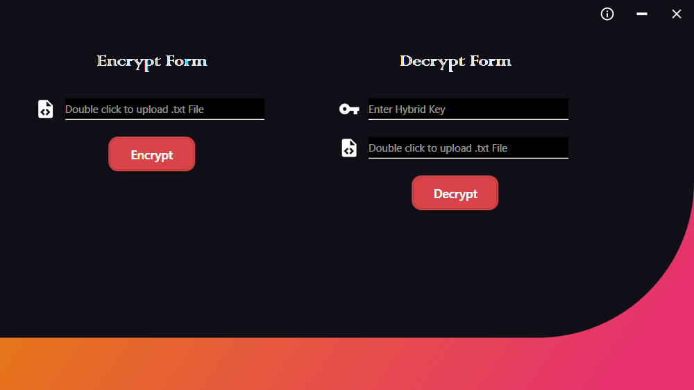
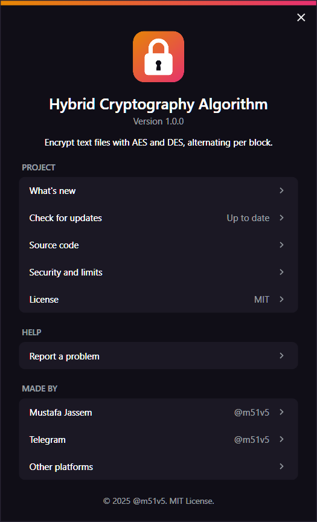

<div align="center">

# Hybrid Cryptography Algorithm

**Encrypt text files with AES and DES, alternating per block.**

[](https://github.com/m51v5/HybridCryptographyAlgorithm/releases/latest)
[](https://github.com/m51v5/HybridCryptographyAlgorithm/releases)
[](#download)
[](LICENSE)
[](https://github.com/m51v5/HybridCryptographyAlgorithm/actions/workflows/ci.yml)

© 2025–present · [@m51v5](https://github.com/m51v5) · [m51v5.com](https://m51v5.com)

</div>

---



Hybrid Cryptography Algorithm is a small Windows app that shows how a hybrid cipher works: it encrypts a text file block by block, switching between AES and DES for each block, and decrypts it back with one combined key.

> ⚠️ **For learning only.** DES is broken and the keys aren't generated securely, so don't use it to protect real data. [SECURITY.md](SECURITY.md) lists every weakness.

## Features

- **Hybrid encryption:** AES-128 and DES in turns, one 16-byte block at a time.
- **One key for both:** a fresh random AES and DES key for each encryption, shown as a single hybrid key.
- **Any text:** works with every language and emoji, since text is handled as UTF-8 bytes.
- **File in, file out:** pick a `.txt` file, save the result where you want.
- **Single exe:** nothing to install, no settings, no logs.



---

## Download

Grab the latest zip from the [Releases](https://github.com/m51v5/HybridCryptographyAlgorithm/releases/latest) page.

| File | Contents |
|---|---|
| `hybrid-cryptography-algorithm-<version>-windows-x64.zip` | `HybridCryptographyAlgorithm.exe`, `LICENSE`, `THIRD_PARTY_LICENSES.txt` |

Unzip it and run `HybridCryptographyAlgorithm.exe`.

- Windows 10 or 11, 64-bit
- Nothing to install: the .NET runtime is inside the exe, which is why it's about 70 MB
- The exe isn't code-signed, so Windows SmartScreen may warn you the first time: choose **More info**, then **Run anyway**

---

## Quick start

1. **Encrypt:** double-click the box on the left, pick a `.txt` file, and press **Encrypt**. Save the cipher file.
2. The hybrid key and the cipher file's path fill in on the right. Copy the key somewhere if you want to decrypt later.
3. **Decrypt:** with the key and a cipher file on the right, press **Decrypt** and save the result. It matches the original text exactly.

Buttons at the top right: ⓘ About, minimize, close. Drag the window by its background to move it.

---

## How it works

### Encryption

1. A random 16-byte AES key and 8-byte DES key are made.
2. The text is turned into UTF-8 bytes and cut into 16-byte blocks; the last one can be shorter.
3. Blocks are encrypted in turns, both in CBC mode with PKCS7 padding:
   - block 1 → AES
   - block 2 → DES
   - block 3 → AES, and so on
4. Each encrypted block becomes Base64, and the blocks are joined with `.`.

### Decryption

1. The hybrid key is split back into the DES and AES keys.
2. The cipher text is split at each `.`.
3. Blocks are decrypted in the same turns, AES first, and the bytes are joined back into text.

### Hybrid key

```
Base64(DES key) + Base64(AES key)
 12 characters     24 characters
```

You need the whole key, and the cipher file, to get the text back.

---

## Privacy and updates

- **Your text and keys stay on your PC.** The app reads only the file you pick, writes only where you save, and keeps no history or logs.
- **Update check:** a few seconds after it opens, and when you click **Check for updates** in About, the app asks GitHub for the latest release. That one request tells GitHub your IP address and the app's version, nothing else. It never downloads anything: if a new version is out, the ⓘ button gets a dot, and About offers to open the release page.

Details are in [SECURITY.md](SECURITY.md).

---

## Documentation

- [Development guide](docs/DEVELOPMENT.md): running from source, checks, the cipher format, and publishing a release.

---

## Build from source

You need the [.NET 8 SDK](https://dotnet.microsoft.com/download/dotnet/8.0) on Windows.

```
git clone https://github.com/m51v5/HybridCryptographyAlgorithm.git
cd HybridCryptographyAlgorithm
dotnet run --project src/HybridCryptographyAlgorithm
```

Or open `HybridCryptographyAlgorithm.sln` in Visual Studio 2022 and press F5.

---

## Notes

- The app saves nothing of its own. To remove it, delete the exe; your encrypted and decrypted files stay where you saved them.
- Third-party licenses, including the .NET runtime's, are in `THIRD_PARTY_LICENSES.txt` in the zip.

---

## Background

Originally created as part of a **Security and Cryptography course** during university, focusing on the hybrid encryption logic rather than the UI.

Developed by **[@m51v5](https://m51v5.com)** as a university project in the *Information Security* course (3rd year) at the University of Information Technology and Communications (UoITC).

---

## Contributing and support

- Found a bug or have an idea? [Open an issue](https://github.com/m51v5/HybridCryptographyAlgorithm/issues/new/choose).
- Want to help? Read the [contributing guide](CONTRIBUTING.md) and the [code of conduct](https://github.com/m51v5/.github/blob/main/CODE_OF_CONDUCT.md).
- Found a security problem? See [SECURITY.md](SECURITY.md).
- Other ways to reach me: [m51v5.com/contact](https://m51v5.com/contact).

---

## License

[MIT](LICENSE) © [@m51v5](https://m51v5.com)
